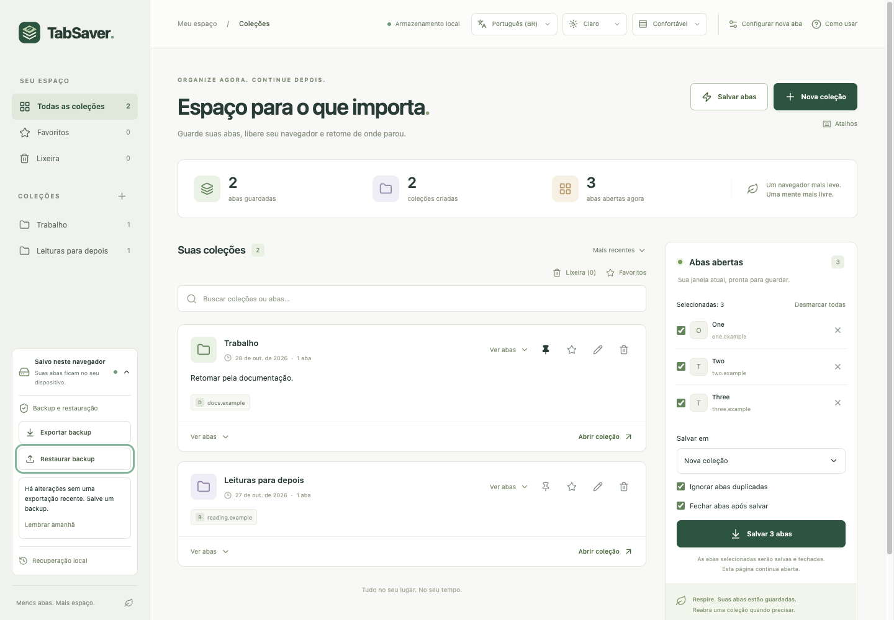

# TabSaver

**Menos abas. Mais espaço.**

TabSaver é uma extensão open source para Chrome que salva suas abas em coleções locais, permite fechá-las para liberar recursos e ajuda a retomar o trabalho depois. Sem conta, sem servidor e sem sincronização obrigatória.

Desenvolvido por [Roger Arruda](https://rogerarruda.dev) · [Licença MIT](LICENSE) · [Privacidade](PRIVACY.md) · [Reportar um problema](https://github.com/rogerarruda/tabsaver/issues)



## Recursos

- Coleções com nomes, notas, etiquetas, favoritos e opção de fixar no topo.
- Salvamento de todas as abas da janela ou apenas das selecionadas, em coleções novas ou existentes.
- Fechamento opcional após salvar, com confirmação antes de fechar.
- Salvamento rápido pelo botão com raio, atalhos de teclado e menu de contexto.
- Busca global por título, endereço, nome da coleção, notas ou etiquetas.
- Reabertura de uma coleção inteira ou apenas das abas escolhidas, em lotes com progresso e interrupção.
- Preservação de nome, cor e estado recolhido dos grupos do Chrome em novos salvamentos.
- Movimentação de abas por arrastar e soltar ou pela opção **Mover para**.
- Lixeira para restaurar abas e coleções removidas.
- Backup e restauração por JSON, com recuperação automática local.
- Português (Brasil) e inglês, temas claro/escuro e densidade confortável/compacta.

## Instalação

A instalação descrita aqui é manual. A opção pela Chrome Web Store será adicionada quando estiver disponível. Use somente builds de uma origem em que você confia.

### Opção 1: instalar um build pronto

Se houver um pacote compilado para Chrome em [Releases](https://github.com/rogerarruda/tabsaver/releases):

1. Baixe o arquivo do **build da extensão** e extraia o ZIP para uma pasta permanente.
2. No Chrome, abra `chrome://extensions`.
3. Ative **Modo do desenvolvedor**.
4. Clique em **Carregar sem compactação** (*Load unpacked*).
5. Selecione a pasta que contém o `manifest.json` **compilado**.
6. Abra o TabSaver pelo ícone no menu de extensões ou abra uma nova aba.

Não selecione o ZIP nem o arquivo `manifest.json` individualmente. Os arquivos automáticos **Source code (zip/tar.gz)** do GitHub contêm o código-fonte e precisam ser compilados usando a opção abaixo.

### Opção 2: compilar a partir do código-fonte (*from source*)

Requisitos: **Git, Node.js 22 ou superior, npm e Google Chrome**. O ambiente usado na validação foi Node.js 22 com npm 10. Não são necessários conta Google, API key, OAuth ou arquivo `.env`.

A implementação atual está na branch `develop`:

```bash
git clone --branch develop https://github.com/rogerarruda/tabsaver.git
cd tabsaver
npm ci
npm run build
```

Depois:

1. Abra `chrome://extensions` e ative **Modo do desenvolvedor**.
2. Clique em **Carregar sem compactação**.
3. Selecione **`dist/chrome`** dentro do projeto.

A pasta raiz do repositório contém TypeScript e Vue e não deve ser carregada diretamente como extensão. O build gera os arquivos executáveis e o manifesto ajustado em `dist/chrome`.

O `package-lock.json` fixa as versões usadas na instalação. Use `npm ci` para reproduzir esse conjunto de dependências.

### Atualizar uma instalação manual

Antes de atualizar, exporte um backup pelo card **Salvo neste navegador**.

- **Instalação por build:** substitua os arquivos na mesma pasta usada na instalação.
- **Instalação pelo fonte:** atualize o código e execute `npm ci` e `npm run build` novamente.
- Em `chrome://extensions`, clique em **Recarregar** no card do TabSaver e atualize as páginas da extensão que já estiverem abertas.

Mantenha o mesmo perfil do Chrome e a mesma pasta de instalação. Remover a extensão para reinstalá-la pode apagar seus dados locais. Se instalar em outro perfil ou mudar de uma instalação manual para a futura versão da loja, use o backup exportado para transferir suas coleções.

A instalação sem compactação segue o [guia oficial do Chrome](https://developer.chrome.com/docs/extensions/get-started/tutorial/hello-world#load-unpacked).

## Como usar

### Abrir o TabSaver

Clique no ícone da extensão na barra do Chrome. Se necessário, use o menu de extensões para fixá-lo. O TabSaver também declara sua página como a nova aba do navegador.

Se o Chrome solicitar confirmação para manter a nova página, aceite para usá-la. Caso outra extensão controle a nova aba ou você prefira sua página atual, o acesso pelo ícone continua funcionando. **Configurar nova aba** oferece instruções e acesso às configurações; não força uma mudança nas preferências do Chrome.

O tutorial aparece na primeira visita e pode ser reaberto em **Como usar**.

### Salvar abas

1. No painel **Abas abertas**, marque as páginas que deseja guardar.
2. Em **Salvar em**, escolha uma nova coleção ou busque uma existente.
3. Escolha se deseja ignorar duplicatas e fechar as abas após salvar.
4. Clique em **Salvar** e confirme o fechamento, se solicitado.

As abas só são fechadas depois da gravação dos dados. A página do TabSaver permanece aberta.

Para guardar a janela inteira, clique em **⚡ Salvar abas**, ao lado de **Nova coleção**. Esse atalho cria uma nova sessão, ignora duplicatas e pede confirmação antes de fechar. A seleção e as opções do painel não filtram o salvamento rápido.

O menu de contexto do Chrome também permite salvar a página ou um link em **Salvos rápidos**, sem fechar a aba. Um selo `✓` no ícone indica sucesso e `!` indica falha.

### Organizar e encontrar páginas

- Crie coleções pelo botão **Nova coleção**.
- Use o lápis para editar nome, etiquetas e notas.
- A estrela marca favoritos; o alfinete mantém uma coleção no topo.
- Em **Ver abas**, adicione um endereço HTTP/HTTPS, remova uma página ou mova-a para outra coleção. É possível arrastar pela alça para um cartão ou para uma coleção na barra lateral.
- A busca encontra abas em todas as coleções. Clique no nome da coleção em um resultado para localizá-la e expandi-la.
- Coleções e abas excluídas vão para a **Lixeira**, onde podem ser restauradas ou removidas definitivamente.

### Reabrir abas

Use **Abrir coleção** para abrir todas ou expanda **Ver abas**, marque as páginas e clique em **Abrir selecionadas**. Reabrir não remove as páginas da coleção.

A abertura ocorre em segundo plano, em lotes de cinco, com uma pausa entre os lotes. **Interromper abertura** cancela as próximas aberturas e mantém as páginas já abertas. Dez ou mais novas abas exigem confirmação sobre o uso de recursos.

Endereços já abertos na janela e duplicatas são ignorados. Apenas as páginas recém-abertas entram nos grupos recriados; abas existentes não são movidas.

### Backup e recuperação

Na barra lateral, expanda o card **Salvo neste navegador**. Em telas estreitas, esse card fica junto do logotipo, acima do conteúdo principal.

| Ação | O que faz |
| --- | --- |
| **Exportar backup** | Prepara um JSON com coleções, notas, grupos salvos, preferências e lixeira. |
| **Restaurar backup** | Abre um arquivo JSON do TabSaver de até 20 MB e mostra uma prévia antes de importar. |
| **Adicionar às coleções atuais** | Mantém os dados existentes e adiciona os do backup, evitando coleções idênticas. |
| **Substituir todas as coleções** | Troca as coleções pelas do arquivo. A restauração de preferências é opcional. |
| **Desfazer restauração** | Recupera o estado anterior à última importação; alterações posteriores também são substituídas. |
| **Recuperação local** | Permite escolher uma cópia automática anterior de coleções e lixeira. |

Importar ou recuperar dados não abre nem fecha abas do navegador. Backups antigos sem lixeira continuam aceitos e mantêm a lixeira atual.

Antes de alterar coleções ou a lixeira, a extensão guarda o estado anterior na mesma operação de armazenamento. São mantidas até cinco cópias recentes; bibliotecas grandes podem ter menos cópias para limitar o espaço ocupado. Restaurar uma cópia local também cria uma cópia do estado substituído. As preferências não são alteradas pela recuperação local.

Essas cópias ficam no próprio navegador e não substituem arquivos exportados. O JSON é legível e não tem criptografia adicional. Guarde-o em um local seguro. O histórico automático e a cópia de desfazer não entram no arquivo exportado.

O lembrete de backup pode ser adiado até o dia seguinte. **Última exportação preparada** informa quando o download foi iniciado, sem garantir que o arquivo tenha sido salvo pelo usuário.

### Atalhos e preferências

Atalhos sugeridos, sujeitos a conflitos e à atribuição do Chrome:

| Atalho | Ação |
| --- | --- |
| `Alt + Shift + S` | Abre o salvamento rápido para confirmação. |
| `Alt + Shift + T` | Abre o TabSaver. |

No macOS, use **Option** no lugar de Alt. **Atalhos**, no topo da interface, mostra as combinações realmente atribuídas e oferece acesso a `chrome://extensions/shortcuts` para alterá-las.

Também no topo:

- **Idioma:** Automático, Português (BR) ou English. Automático usa PT-BR para navegadores em português e inglês para os demais idiomas.
- **Aparência:** Sistema, Claro ou Escuro.
- **Densidade:** Confortável ou Compacto.

As preferências são salvas no navegador e acompanham os backups exportados.

## Privacidade e permissões

O TabSaver armazena seus dados no perfil local do Chrome. Não usa conta, anúncios, analytics, rastreamento nem envio de coleções para servidores. A sincronização com Google Drive ainda não está implementada.

| Permissão | Finalidade |
| --- | --- |
| `tabs` | Ler títulos e endereços das abas da janela, salvar, reabrir e fechar páginas mediante as ações do usuário. |
| `storage` | Guardar coleções, preferências, lixeira e cópias de recuperação localmente. |
| `favicon` | Exibir ícones usando a API interna de favicons do Chrome, sem integrar um serviço externo de imagens. |
| `contextMenus` | Oferecer as opções de salvar página ou link pelo menu de contexto. |
| `tabGroups` | Ler e recriar nome, cor e estado recolhido dos grupos de abas. |

A nova aba é declarada no manifesto por `chrome_url_overrides`. A extensão não solicita acesso ao conteúdo das páginas por scripts nem permissão de histórico de navegação.

Ao reabrir uma página ou visitar o site do desenvolvedor, o navegador acessa o respectivo site normalmente. Dados locais, lixeira e arquivos de backup podem conter URLs pessoais ou sensíveis. Veja a [política de privacidade completa](PRIVACY.md).

## Limitações

- Os dados não são sincronizados entre dispositivos ou perfis. Não há integração ativa com Google Drive.
- Fechar abas pode reduzir o consumo de recursos; não há medição de RAM nem garantia de uma economia específica. Reabrir muitas páginas continua podendo consumir bastante memória, mesmo em lotes.
- São salvos endereços, títulos e metadados de organização. Formulários não enviados, posição de rolagem, histórico de voltar/avançar, login e estado interno das páginas não são preservados pelo TabSaver.
- Links já abertos e duplicados são ignorados na restauração. Consultas e fragmentos diferentes são tratados como endereços distintos.
- Algumas páginas internas ou endereços restritos podem não ser reabertos pelo Chrome.
- Grupos são preservados em novos salvamentos. Coleções antigas sem esses metadados abrem normalmente, sem recriar grupos.
- Dados antigos incompatíveis são preservados e podem ser exportados, mas a edição de abas dessas coleções pode ficar bloqueada para evitar perda de informações.
- O armazenamento tem espaço limitado. Uma falha de gravação pode impedir uma operação e, nesse caso, as abas não são fechadas automaticamente.
- Desinstalar a extensão, apagar o perfil ou limpar seus dados pode remover coleções e cópias locais. Exporte backups regularmente.
- A lixeira não expira automaticamente. Cópias de recuperação e arquivos exportados anteriormente podem conter itens excluídos depois.
- O alvo de build e validação atual é o Chrome. Outros navegadores não têm compatibilidade garantida.

## Desenvolvimento

O projeto usa **Vue 3, TypeScript, Lucide e Extension.js**, com Manifest V3. A versão da ferramenta de build e as dependências resolvidas estão fixadas no projeto.

```bash
npm ci
npm run dev
```

Comandos disponíveis:

| Comando | Finalidade |
| --- | --- |
| `npm run dev` | Desenvolvimento com recompilação após alterações. |
| `npm start` | Inicia a extensão em modo de produção pela ferramenta de desenvolvimento. |
| `npm run build` | Gera o build de produção em `dist/chrome`. |
| `npm test` | Gera o build e executa os testes automatizados. |
| `npm run release:check -- vX.Y.Z` | Confere se a tag e as versões do projeto estão alinhadas. |

Estrutura principal:

```text
src/                  Interface, armazenamento e funcionalidades
src/background.ts     Ícone, menu de contexto e comandos de teclado
src/translations.ts   Traduções PT-BR → EN
images/               Logo e ícones da extensão
scripts/              Documentos do build e validação de versões
.github/              CI, releases e atualizações de dependências
manifest.json         Manifesto de origem
tests/               Testes de dados e APIs simuladas
design-review/        Capturas com dados fictícios e registros de revisão
PRIVACY.md            Política de privacidade
LICENSE               Licença MIT
```

Os testes usam a API Chrome simulada; os testes do processo em segundo plano também verificam o código de produção gerado. Depois de mudar recursos que usam o navegador, confira a extensão instalada: salvar/fechar, reabrir seleção e grupos, cancelar lotes, exportar/importar, recuperar dados e usar atalhos. A prévia em uma página web comum não acessa abas reais.

### Gerar um pacote para distribuição

Depois de `npm run build`, compacte **o conteúdo de `dist/chrome`**, com o `manifest.json` na raiz do ZIP. Por exemplo, em um ambiente com o comando `zip`:

```bash
cd dist/chrome
zip -r ../../tabsaver-chrome.zip .
```

O build inclui `LICENSE` e `PRIVACY.md` automaticamente. Esse é o pacote compilado para uma release ou para o fluxo de envio à loja. Não inclua `node_modules`, backups pessoais ou o repositório inteiro. A publicação na Chrome Web Store depende também do cadastro, dos materiais da listagem e da revisão da plataforma; gerar o ZIP não publica a extensão.

### Releases automáticas no GitHub

O workflow [Release](.github/workflows/release.yml) roda quando uma tag `vX.Y.Z` é enviada ao GitHub. Ele valida as versões, instala as dependências com `npm ci`, executa os testes, gera o build e publica uma release com:

- `tabsaver-chrome-vX.Y.Z.zip`: extensão compilada, com o manifesto na raiz, licença e política de privacidade.
- `SHA256SUMS.txt`: soma SHA-256 do ZIP para conferir a integridade do download.
- Notas geradas pelo GitHub e instruções breves de instalação.

Para publicar a versão atual, depois de revisar e enviar os commits que contêm esta configuração:

```bash
git switch develop
npm run release:check -- v0.0.2
git push origin develop
git tag -a v0.0.2 -m "TabSaver v0.0.2"
git push origin v0.0.2
```

Acompanhe a execução na aba **Actions** e o resultado em [Releases](https://github.com/rogerarruda/tabsaver/releases). Criar uma tag apenas no computador não inicia a automação; é necessário enviá-la ao GitHub.

Para a próxima versão, atualize `package.json`, `package-lock.json` (incluindo a versão raiz) e `manifest.json` para o mesmo número, faça o commit e envie uma nova tag correspondente. `npm version patch --no-git-tag-version` atualiza os arquivos npm; o manifesto precisa ser atualizado também. Confirme o número final com `npm run release:check -- vX.Y.Z` antes de criar a tag.

O fluxo aceita versões estáveis com três números, como `v0.0.3`. Uma tag diferente das versões dos arquivos interrompe a publicação. Uma release existente não é sobrescrita: use uma nova versão para novos pacotes.

Não é necessário cadastrar um token pessoal: o workflow usa o `GITHUB_TOKEN` fornecido pelo GitHub, com permissão de escrita apenas no job de publicação. O repositório precisa permitir GitHub Actions e criação de releases. Esta automação não publica na Chrome Web Store.

Referência: [criação de releases pelo GitHub CLI](https://cli.github.com/manual/gh_release_create).

### CI e Dependabot

O workflow [CI](.github/workflows/ci.yml) executa o build e os testes em pushes e pull requests para `main` e `develop`, incluindo PRs de dependências.

A configuração [Dependabot](.github/dependabot.yml) verifica dependências npm e GitHub Actions semanalmente, às segundas-feiras às 09h no fuso de São Paulo. Os PRs de atualização de versão são direcionados para `develop`, com limite de cinco PRs abertos por ecossistema. Atualizações menores e correções são agrupadas; versões principais são abertas separadamente para revisão. Não há mesclagem automática.

Para ativar o Dependabot, esta configuração precisa estar também na **branch padrão do repositório**, atualmente `main`, mesmo que os PRs tenham `develop` como destino. Leve os arquivos para `main` pelo fluxo normal de revisão. Nas configurações de segurança do repositório, habilite também **Dependabot alerts** e **Dependabot security updates** se quiser alertas e correções automáticas de vulnerabilidades; essas correções usam a branch padrão e não seguem necessariamente o agendamento de atualização de versões.

Referência: [configuração oficial do Dependabot](https://docs.github.com/en/code-security/reference/supply-chain-security/dependabot-options-reference).

### Contribuir

Sugestões e correções são bem-vindas em [Issues](https://github.com/rogerarruda/tabsaver/issues) e pull requests. Descreva o comportamento esperado, as etapas para reproduzir e a versão do Chrome. Use dados fictícios nas capturas e exemplos; não publique suas coleções ou backups pessoais.

Para contribuir com código, crie uma branch a partir de `develop`, mantenha as traduções em português e inglês, preserve a compatibilidade dos dados existentes e execute `npm test` antes de enviar o pull request.

## Licença

Distribuído sob a [licença MIT](LICENSE). Você pode usar, modificar e redistribuir o código conforme os termos da licença, mantendo o aviso de copyright e a licença. As dependências mantêm suas respectivas licenças.

Desenvolvido por [Roger Arruda](https://rogerarruda.dev).
